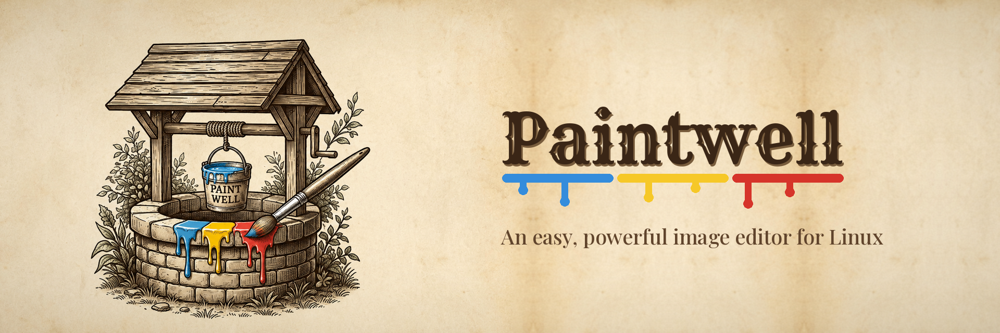

<p align="center"></p>

# Paintwell

**An easy, powerful image editor for Linux**, with a lot more under the bonnet than a basic
image editor: smart photo fixes, real layers, text you can always re-edit, a full set of
adjustments and 50+ effects, all in a clean, familiar layout.

[](https://snapcraft.io/paintwell)

<p align="center">

  
    
</p>

## Features

**Smart photo fixes**
- Content-Aware Fill: select something you don't want and Paintwell fills the gap using the picture around it.
- Remove tool: brush over small blemishes, spots, wires or unwanted objects to blend them away.
- Red Eye, plus Clone Stamp, Dodge, Burn, Sponge, Blur, Sharpen and Smudge for touch-ups by hand.

Results depend on the picture. The smart fixes work best on smaller areas with simple, even
surroundings such as sky, grass, sand or walls. Large or detailed areas may need finishing
with the Clone Stamp.

**Selections**
- Magic Wand that updates live as you move the Tolerance slider.
- Magnetic Lasso that snaps to edges as you trace around an object.
- Rectangle, ellipse and freehand lasso, plus add to and subtract from any selection.

**Layers and text**
- Layers with blend modes and opacity, saved in the open, layered OpenRaster (.ora) format,
  which GIMP and Krita can also open.
- Text on its own layer that you can re-edit at any time: horizontal, vertical, on an arc or
  a wave, with rotation, outlines, drop shadows, and letter and line spacing.

**Adjustments and 50+ effects**
- Adjustments: Levels, Curves, Hue / Saturation, Brightness / Contrast, Auto-Level, Black and
  White, Sepia, Posterise and Invert.
- Artistic, Photo, Blurs, Distort, Noise and Stylise effects, all with live preview.
- Frames and borders: picture frames (moulded, wood, gold, silver and more, with a mount),
  drop shadows, rounded corners, and soft or rough edges.
- Render: realistic clouds and skies, Lens Flare, Lighting Effects, Starfield, Rain and Snow,
  Sunburst, Julia and Mandelbrot fractals, Plasma, and wood, marble and granite textures.

**Made for getting work done**
- Several images open at once in tabs; opening a picture from your file manager adds it to
  the Paintwell that's already open.
- Unlimited undo, with a History panel to jump back to any step.
- Navigator, rulers and guides, a pixel grid, and light and dark themes.
- Dockable Tools, Colours, History, Layers and Navigator panels.
- Print with a preview and size options, and scan straight into Paintwell, including from
  network printer-scanners without extra drivers.
- Opens and saves PNG, JPEG, BMP, WebP, TIFF, GIF and more, plus layered OpenRaster.

## Install

**Snap Store** (recommended: updates itself)

```
sudo snap install paintwell
```

For USB drives and USB scanners, allow access once:

```
sudo snap connect paintwell:removable-media
sudo snap connect paintwell:raw-usb
```

**AppImage**: download `Paintwell-x86_64.AppImage` from the
[Releases](https://github.com/bobwellapps/paintwell/releases) page, then:

```
chmod +x Paintwell-x86_64.AppImage
./Paintwell-x86_64.AppImage
```

It needs a 64-bit distro from about 2021 or newer (glibc 2.34+). If it won't start, install
FUSE (`sudo apt install libfuse2`). To add it to your menu, use Gear Lever or AppImageLauncher.

**From source** (Python 3.10+):

```
pip install PySide6-Essentials numpy
python3 -m paintwell
```

## Building the snap

Everything is in `snap/`, and `snap-tools/` has scripts for setup, building and publishing.
See [SNAP-RELEASE.md](SNAP-RELEASE.md).

## Reporting problems

Please open an [issue](https://github.com/bobwellapps/paintwell/issues). Say what you did,
what happened, and whether you use the snap or the AppImage.

## Licence

Copyright (C) 2026 bobwellapps

Paintwell is free software, released under the GNU General Public License, version 3 or
(at your option) any later version (GPL-3.0-or-later). See [LICENSE](LICENSE) for the full text.

The **Paintwell name and icon** are not covered by the licence and may not be used for other
projects, including modified versions (forks). See [TRADEMARKS.md](TRADEMARKS.md).
